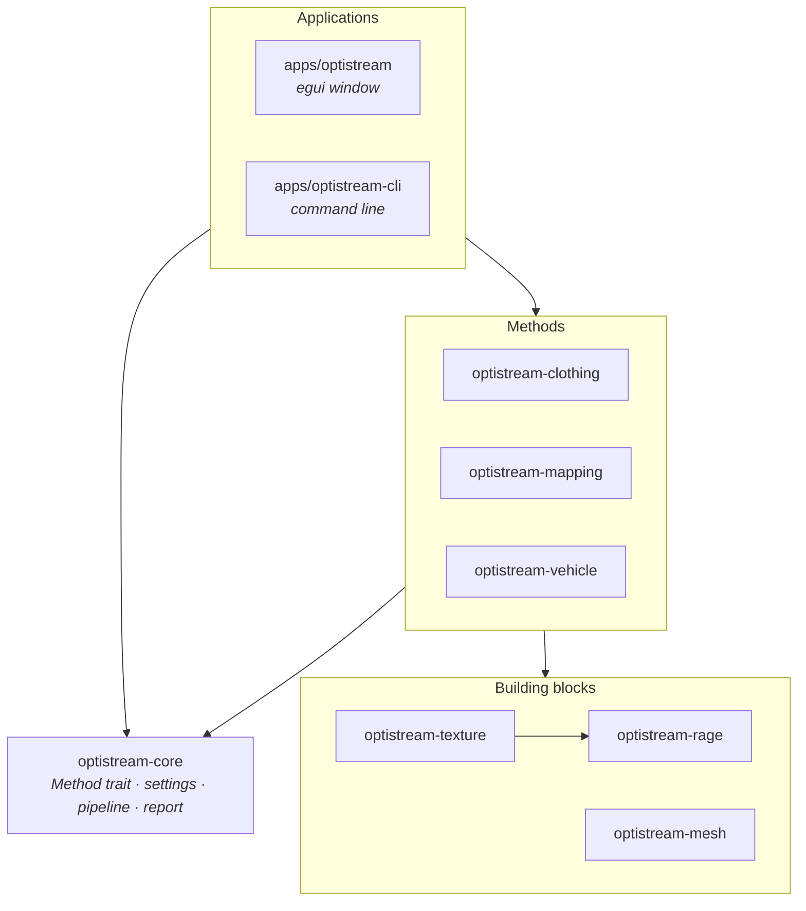

# OptiStream

OptiStream optimises FiveM stream resources (GTA V **Legacy**) so they stay under the engine's memory budgets without breaking in game. It handles three kinds of resources:

- **Clothing / EUP**: addon clothing and EUP packs (`.ydd` / `.ytd`)
- **Mappings / MLO**: `.ytd` files and textures embedded in `.ydr` / `.ydd`
- **Vehicles**: `.ytd` files, plus textures and geometry in `.yft`

It ships as a desktop app (egui) and a command-line tool. Both use the same optimisation pipeline.

## What it does

- **Memory threshold**: a file is only touched when its declared physical or virtual memory is above the threshold. The default is 16 MiB, which is FiveM's warning limit.
- **Textures**:
  - Uncompressed, BC7 and DXT3 textures are converted to DXT1 / DXT5.
  - Sizes that aren't a power of two are rounded down, and incomplete mip chains are completed.
  - When a file is still over budget, textures are reduced one at a time, starting with the ones that lose the least detail. The loss is always measured against the original texture.
- **Geometry**:
  - Decimation keeps skinning intact: original vertices are kept, and borders, UV seams and bone boundaries are locked.
  - Triangle order is optimised without loss.
  - The system segment is repacked, which lowers virtual memory.
- **RSC7**: graphics pages are repacked and the RSC7 flags recomputed, since that is what FiveM measures.
- **Never touched**: file names, drawable indices, cloth geometry, palettes, emissive and `script_rt` textures, collision / physics, and encrypted (FXAP) files.

Each method has three presets: **Léger** (fixes only), **Équilibré** (the default, targeted reduction) and **Fort** (stronger reduction, and it can force a file under budget). You can change every setting individually.

> Always test the optimised resource in game before putting it into production.

## Usage

### Desktop app

1. Run `optistream` (or drag a resource folder onto the executable).
2. Pick the resource type, the resource folder (the one with `fxmanifest.lua` and `stream/`), or a category folder such as `[my-mappings]`, and a preset.
3. Choose the output. You can **export a new resource**, or **modify the folder in place**, which overwrites the originals with no backup.
4. **Analyse**, then optionally **compare before / after** on a file. Then **Optimise** and read the **Report** tab.

### Command line

```
optistream-cli analyze  <resource> [--method clothing|mapping|vehicle] [--preset leger|equilibre|fort] [--only <relative path>]...
optistream-cli optimize <resource> (--out <dir> [--overwrite] | --in-place) [--method ...] [--preset ...] [--set key=value]... [--only <relative path>]...
optistream-cli crops    <resource>      # UV crop diagnostics (clothing)
optistream-cli inspect  <file>...       # dump RSC7 / texture / drawable details
optistream-cli verify   <file>...       # every texture level decodes, every index is valid, segment sizes match flags
```

## Building

Requires a stable Rust toolchain.

```
cargo build --release
cargo test --workspace
```

The binaries are written to `target/release/` as `optistream` and `optistream-cli` (`.exe` on Windows). Linux builds need the usual egui system libraries; see `.github/workflows/ci.yml` for the exact package list.

## Architecture

The project is a Cargo workspace organised in three layers:

- **Applications** handle the user interface. They only know the `Method` trait and the pipeline.
- **Methods** decide *what* to optimise. There is one method per resource type.
- **Building blocks** read and write the RAGE format and process textures and meshes. They know nothing about FiveM or resource types.



| Crate | Role |
|---|---|
| `crates/optistream-rage` | RSC7 container, page packing, texture / drawable / fragment (`.yft`) structures, system segment repacking |
| `crates/optistream-texture` | Decoding, resizing, mip chains, DXT encoding, reduction loss metric, budget reduction engine |
| `crates/optistream-mesh` | Skinning-safe decimation and triangle reordering |
| `crates/optistream-core` | `Method` trait, shared settings schema, optimisation pipeline, report |
| `crates/optistream-clothing` | Clothing / EUP method (UV crop, memory threshold, geometry budget) |
| `crates/optistream-mapping` | Mappings / MLO method (targeted texture reduction per resource) |
| `crates/optistream-vehicle` | Vehicle method (liveries, textures and geometry) |
| `apps/optistream` | Desktop application (egui) |
| `apps/optistream-cli` | Command-line front-end |

To add a resource type, create a crate that implements `optistream_core::Method`. Then register it in `registered_methods` (`apps/optistream/src/app/mod.rs`) and in the CLI's `--method` flag.

## Contributing

Contributions are welcome through **pull requests**:

1. Fork the repository and create a branch from `main`.
2. Make your change and add tests where relevant. Run `cargo test --workspace` before pushing.
3. Open a pull request against `main` that describes what changed and why. CI runs the tests and release builds on Linux and Windows, and both must pass.

Commit messages must follow [Conventional Commits](https://www.conventionalcommits.org/en/v1.0.0/):

```
<type>(<scope>): <short summary in the imperative>
```

- **Types**: `feat`, `fix`, `refactor`, `perf`, `test`, `docs`, `ci`, `build`, `chore`
- **Scopes**: usually the crate or area touched, e.g. `rage`, `texture`, `mesh`, `core`, `clothing`, `mapping`, `vehicle`, `apps`, `ci`, `workspace`

Examples taken from the history:

```
feat(vehicle): add vehicle method with texture and geometry reduction
fix(rage): drop the zero tail of each page when re-laying out the system segment
refactor(texture): extract the budget reduction engine shared by mappings
```
